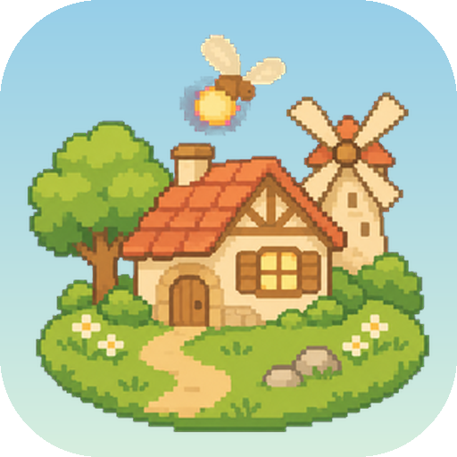
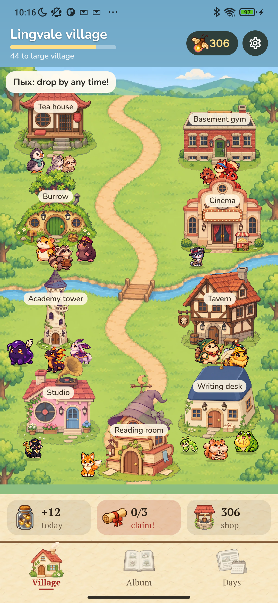
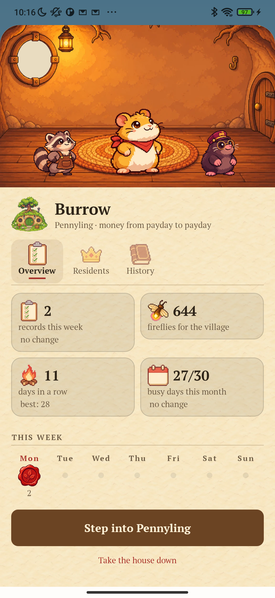
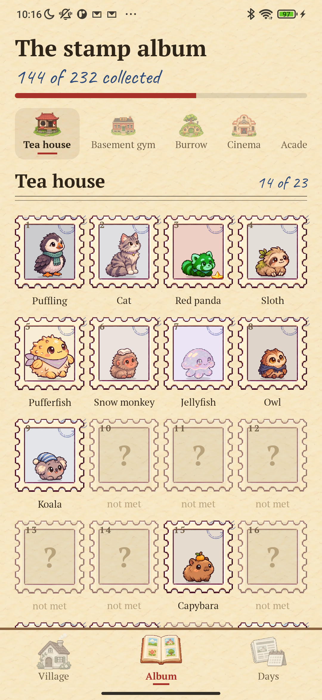
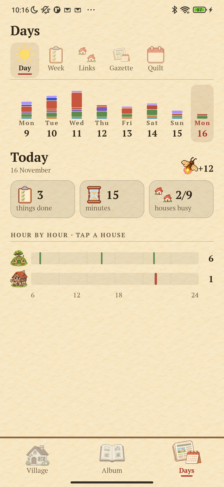

<p align="center"></p>

<h1 align="center">Lingvale</h1>

<p align="center">A village where the pets of all our apps live together.<br>
<a href="https://bigdevwhale.github.io/stillcraft/apps/lingvale/">Website</a> · <a href="https://github.com/bigdevwhale/lingvale/releases/latest/download/Lingvale.apk">Download APK</a> · <a href="README.ru.md">Русский</a></p>

Each of our apps has its own pet and its own home. Puffling's puffins live in a tea house on a cliff, Pumpling's team trains in a basement gym, Pennyling's hamster counts acorns in a burrow. Lingvale brings them into one valley. You choose which houses to build, and the residents and their days move in with the house. There is nothing to type in again.

<p align="center">




</p>

## What's inside

- **The valley.** A pixel map with a path and a stream. Each clearing takes a house: the tea house, the basement gym, the burrow, the cinema, the academy tower, the tavern, the studio, the writing desk or the reading room. The house's team walks in front of it, and at night its windows are lit if something happened there this week.
- **Fireflies.** Everything you do in the apps brings the village fireflies, and more when two or three houses are busy on the same day. The shop sells a well, lamps, a windmill and a hot air balloon for them. The more fireflies gathered, the bigger the village grows, from a hamlet to a small town.
- **Weekly tasks.** Three each week, such as "Two houses busy on the same day, three times".
- **A look inside.** The app's own room with its pets, the week in wax seals, how much was done this week and month, streaks, mornings or evenings, every resident and the house's book.
- **The stamp album.** Every creature of every house: the ones you've met are franked, the rest wait in empty mounts.
- **Days.** The day hour by hour, the week by house, which houses tend to be busy together, a village gazette and a patchwork quilt of the year.

## Which apps move in

Puffling, Pumpling, Pennyling, Reelkin, Inkling, Questling, Songling, Keyling and Familiar, in the versions released alongside Lingvale 1.0 or newer.

## How it works

Every app has a small read-only bridge. Lingvale asks it for the pets, the days and the last week's events, and the app answers only a Lingvale signed with our key. Lingvale changes nothing in the apps and sends nothing anywhere.

## Privacy

No ads, no account, no analytics, no internet permission. Everything stays on the phone. See [PRIVACY.md](PRIVACY.md).

## Build

JDK 17+ (Android Studio's JBR works) and the Android SDK.

```
./gradlew assembleDebug                         # app.lingvale.dev, reads the .dev builds of the apps
./gradlew assembleDebug -Pdemo -Pdemolang=ru    # app.lingvale.demo, reads the .demo builds
```

## License

MIT
