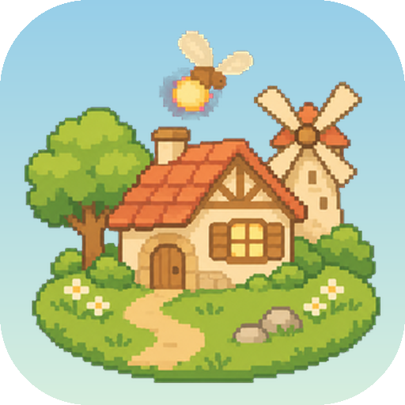
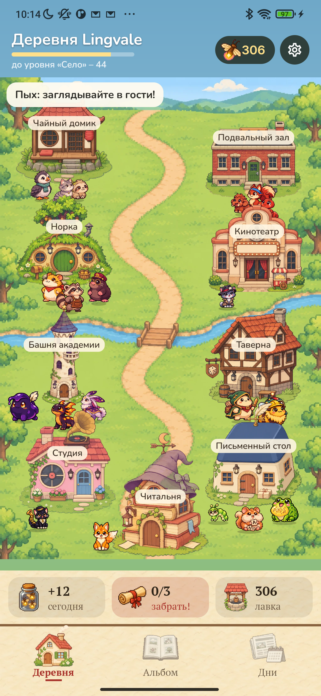
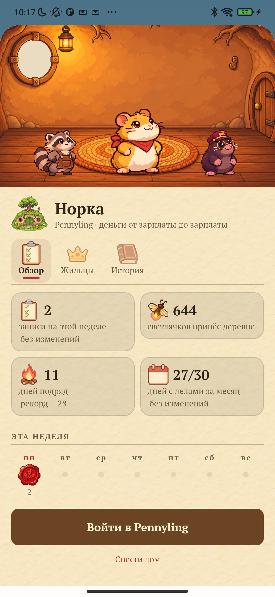
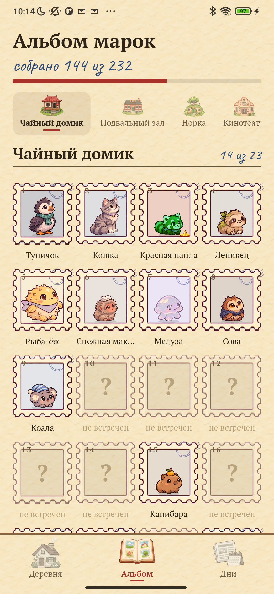
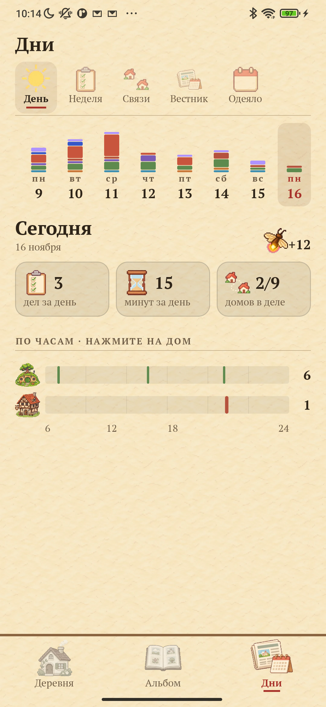

<p align="center"></p>

<h1 align="center">Lingvale</h1>

<p align="center">Деревня, в которой живут питомцы из всех наших приложений.<br>
<a href="https://bigdevwhale.github.io/stillcraft/apps/lingvale/">Сайт</a> · <a href="https://github.com/bigdevwhale/lingvale/releases/latest/download/Lingvale.apk">Скачать APK</a> · <a href="README.md">English</a></p>

У каждого нашего приложения свой питомец и свой дом. Тупики из Puffling живут в чайном домике на скале, команда Pumpling качается в подвальном зале, хомяк из Pennyling считает жёлуди в норке. Lingvale собирает их в одну долину. Вы сами решаете, какие дома построить, а жильцы и их дела переезжают вместе с домом. Ничего не нужно вводить заново.

<p align="center">




</p>

## Что внутри

- **Долина.** Пиксельная карта с тропинкой и ручьём. На каждой поляне можно поставить дом: чайный домик, подвальный зал, норку, кинотеатр, башню академии, таверну, студию, письменный стол или читальню. Перед домами гуляет его команда, а ночью в окнах горит свет, если на неделе в доме что-то происходило.
- **Светлячки.** За каждое дело в приложениях деревня получает светлячков, а если в один день заняты два-три дома – ещё больше. На них в лавке покупают колодец, фонари, мельницу и воздушный шар. Чем больше светлячков собрано, тем выше деревня: от хутора до городка.
- **Задания недели.** Каждую неделю – три задания, например «Два дома в один день – три раза».
- **Заглянуть в дом.** Комната самого приложения с его питомцами, неделя с сургучными печатями, сколько сделано за неделю и месяц, серии, утро или вечер, все жильцы и книга записей.
- **Альбом марок.** Все существа всех домов: встреченные погашены почтовым штемпелем, остальные ждут на пустых местах.
- **Дни.** Лента дня по часам, неделя по домам, какие дома часто бывают заняты в один день, деревенская газета и лоскутное одеяло года.

## Какие приложения уже переезжают

Puffling, Pumpling, Pennyling, Reelkin, Inkling, Questling, Songling, Keyling и Familiar – им нужна версия, вышедшая вместе с Lingvale 1.0 или новее.

## Как это устроено

В каждом приложении есть небольшой мост только для чтения. Lingvale спрашивает у него питомцев, дни и дела за последнюю неделю, а приложение отвечает только Lingvale, подписанному нашим ключом. Lingvale ничего не меняет в приложениях и никуда ничего не отправляет.

## Приватность

Без рекламы, аккаунта и аналитики, даже без доступа в интернет. Всё остаётся на телефоне. Подробнее – в [PRIVACY.md](PRIVACY.md).

## Сборка

Нужны JDK 17+ (подойдёт JBR из Android Studio) и Android SDK.

```
./gradlew assembleDebug                         # app.lingvale.dev, читает .dev-сборки приложений
./gradlew assembleDebug -Pdemo -Pdemolang=ru    # app.lingvale.demo, читает .demo-сборки
```

## Лицензия

MIT
